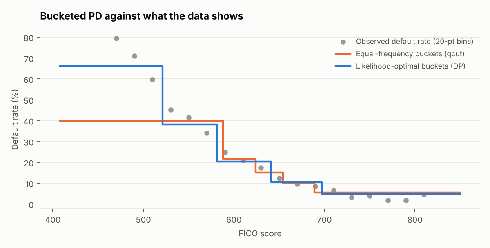
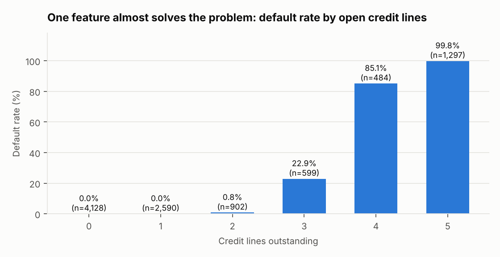
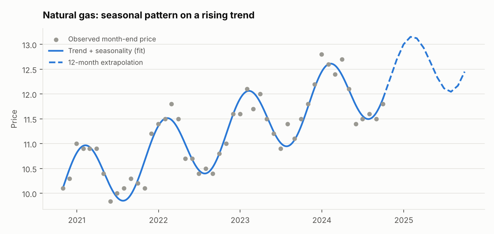

# Credit Risk and Gas Storage Pricing

[](https://github.com/sriharsha-d7/jpmorgan-chase-co.-quantitative-research-virtual-experience-program-on-forage/actions/workflows/ci.yml)

Two quantitative-research problems from the JPMorgan Chase & Co. virtual experience program on Forage,
rebuilt as a small tested Python package plus two executed notebooks:

1. **Credit risk.** Estimate each borrower's probability of default (PD) and expected loss, and map FICO
   scores to a handful of ratings using an exact dynamic-programming optimiser.
2. **Natural-gas storage.** Fit a price curve to four years of month-end prices, extrapolate a year, and
   value a storage contract with real physical constraints.

```bash
pip install -r requirements.txt
pytest                                   # 20 tests
python scripts/build_notebooks.py        # re-executes both notebooks and regenerates docs/*.png
```

## Results

### FICO ratings: dynamic programming beats equal-frequency bins

Bucket boundaries are chosen to maximise the Bernoulli log-likelihood of observed defaults. The DP is exact
over the ~440 distinct FICO scores and is tested against brute force. The usual shortcut, `pd.qcut`, ignores
defaults entirely.

| Buckets | DP log-likelihood | qcut log-likelihood | Gain |
|---|---|---|---|
| 3 | -4319.5 | -4371.8 | +52.3 |
| **5** | **-4255.4** | **-4321.0** | **+65.7** |
| 8 | -4224.3 | -4280.2 | +55.9 |



The 5-rating scale (**rating 1 = best credit**) is monotone, with default rate rising from 4.6% to 66.1%:

| Rating | FICO range | Borrowers | Default rate |
|---|---|---|---|
| 1 | 697-850 | 1,657 | 4.6% |
| 2 | 641-696 | 3,197 | 10.5% |
| 3 | 581-640 | 3,438 | 20.4% |
| 4 | 521-580 | 1,407 | 38.1% |
| 5 | 408-520 | 301 | 66.1% |

### PD model: read the AUC with care

| Model | Held-out ROC-AUC | Brier | 5-fold CV AUC |
|---|---|---|---|
| Rank by `credit_lines_outstanding` only | 0.995 | 0.052 | n/a |
| Rank by `fico_score` only | 0.714 | 0.207 | n/a |
| Logistic regression (scaled) | 0.99999 | 0.0029 | 0.99998 |
| Gradient boosting | 0.99989 | 0.0040 | 0.99992 |

**This is not a model that is unusually good; the data is nearly deterministic.** No borrower with 0-1 open
credit lines defaulted and 99.8% of those with 5 did, so one feature gets AUC 0.995. Real lending books are
far noisier, and these scores would not transfer. The notebook shows this before fitting anything.



Expected loss is `PD x (1 - recovery) x balance` with a 10% recovery rate. `expected_loss()` **warns when an
input is outside the training range**, because the probability is then an extrapolation. The original analysis
reported a 98.8% PD for a borrower whose debt-to-income (0.6) exceeded anything in the data (max 0.40).

### Gas prices: seasonality is what matters

Last 12 months held out, model fitted on the first 36:

| Model | MAE | RMSE | MAPE |
|---|---|---|---|
| Last value carried forward | 0.550 | 0.719 | 4.4% |
| Same month last year | 0.567 | 0.627 | 4.7% |
| Linear trend only | 0.541 | 0.625 | 4.4% |
| **Trend + annual seasonality** | **0.160** | **0.208** | **1.3%** |



A straight-line fit (the first version of this repo) is no better than carrying the last price forward. One
annual harmonic cuts the error by about two thirds. Caveat: with 48 monthly points this backtest is indicative,
not conclusive, and the curve can only be extrapolated one year (the code refuses to price beyond that).

### Storage contract valuation

`price_storage_contract` computes **sales - purchases - storage rent - fees**, with rent charged on inventory
actually held between events. It raises `ValueError` for infeasible plans (overfilling, selling gas not held,
breaching injection/withdrawal rate limits) instead of pricing them. Example (buy 2,000 units in summer 2024,
sell in winter): revenue $26,153, purchases $23,100, storage $736, fees $40, **value $2,277**; the reverse
season loses $1,364.

## Layout

```
src/quant_research/
  fico_buckets.py   exact DP bucketing + rating assignment
  credit_model.py   PD models, baselines, expected loss, out-of-range warnings
  gas_pricing.py    trend+seasonal curve, backtest, contract valuation
  viz.py            figures
notebooks/          01_credit_risk, 02_gas_storage (executed, outputs included)
tests/              20 tests: DP vs brute force, planted-signal recovery, contract arithmetic, infeasible plans
data/               loan_data.csv (10,000 loans), nat_gas.csv (48 month-end prices)
```

## Limitations

- Both data sets come from the Forage exercise. The loan data is near-deterministic (see above) and the gas
  series is short; results illustrate the methods, not real-world performance.
- Contract valuation uses one deterministic price path, with no volatility or optionality.
- Recovery rate (10%) is an exercise assumption, not an estimate.
